

  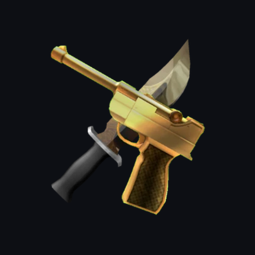

<h1 align="center">RBLXValue: MM2 Values &amp; Trades</h1>

  The free Android app for <a href="https://rblxvalue.com">rblxvalue.com</a>: Murder Mystery 2 (MM2) item values, value history charts, inventory worth, a trade calculator and a Trade Center.

  
  
  

  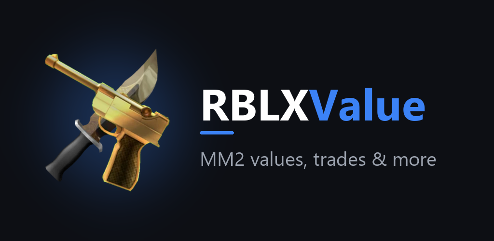

## What is RBLXValue?

RBLXValue is an MM2 value list and trading tool. Instead of relying on one value list, it shows the values from two independent sources (MM2Values and Supreme Values) side by side and combines them into one estimate. The Android app brings everything from the website to your phone, with push notifications for offers, chat messages and watchlist matches.

## Features

**Values and charts**
- Search all MM2 knives, guns, pets and sets
- MM2Values and Supreme Values side by side, combined into one estimated value
- Rarity, demand and a value history chart per item, so you can see if an item is rising or falling
- Full sets with their combined value

**Inventory and watchlist**
- Log in with the official Roblox login (OAuth). RBLXValue never sees your password
- Build your MM2 inventory and see its total value
- Get a notification when an item on your watchlist shows up in a trade

**Trade calculator**
- Add items to both sides and instantly see if an offer is a win, fair or a loss

**Trade Center**
- Browse trades from other players, post your own and receive offers
- Private trade room chat once an offer is accepted
- Reviews and trader reputation on every profile
- Links are filtered and every accepted trade gets a private server provided by RBLXValue, so nobody has to click a stranger's link. Read more: [Trade Center safety](https://rblxvalue.com/security/trade-center)

**Giveaways and rewards**
- App-exclusive MM2 giveaways, only open to players who join from the app
- Earn RBLXv points every day (daily login, app bonus and Trade Center trades) and redeem them for MM2 items on the Rewards page

**For developers**
- Get a free [RBLXValue API](https://docs.rblxvalue.com) key in the app and see usage per day and per endpoint

## Screenshots

  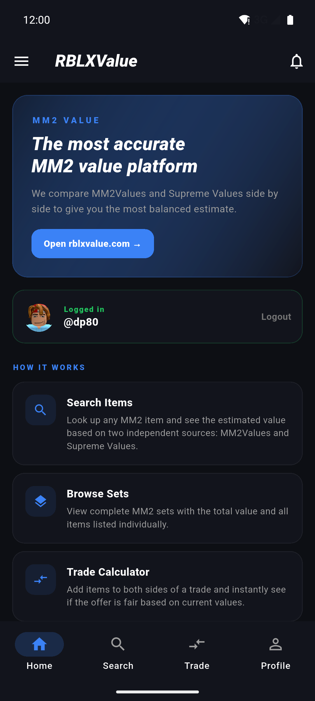
  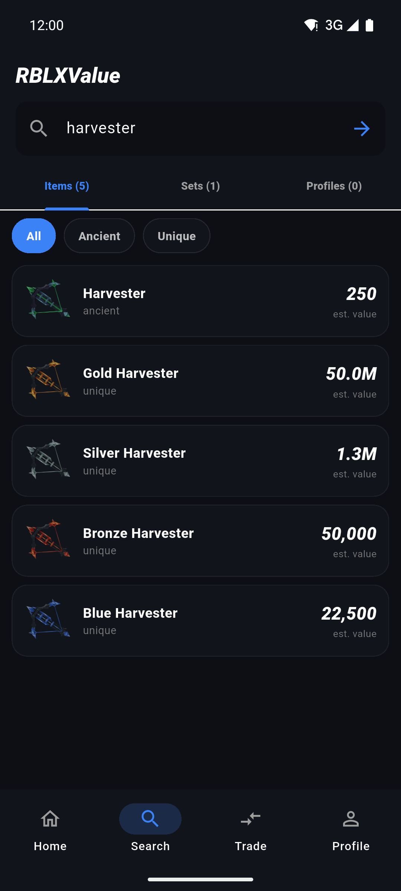
  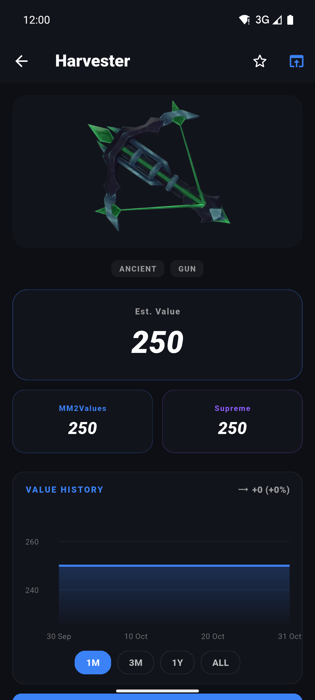
  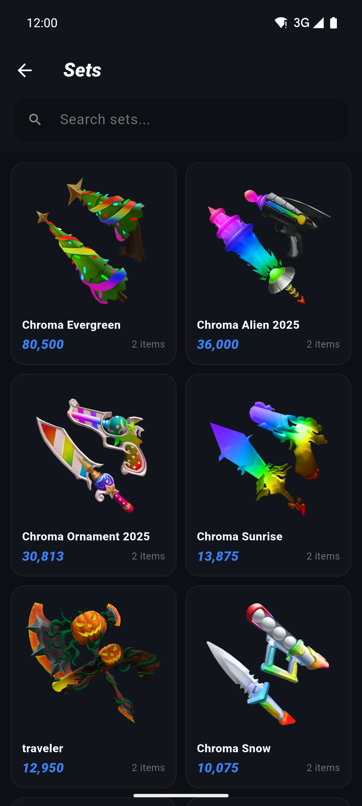

  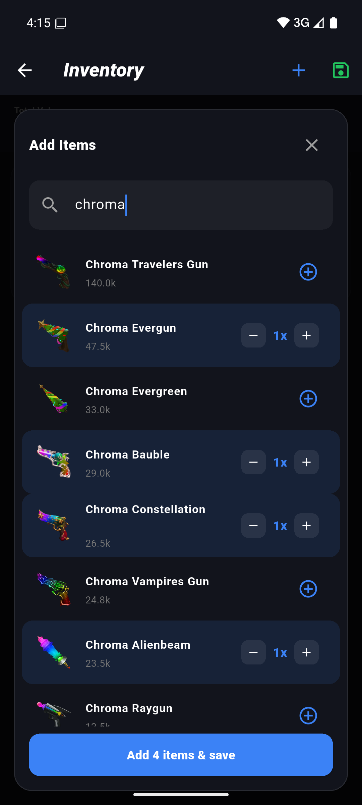
  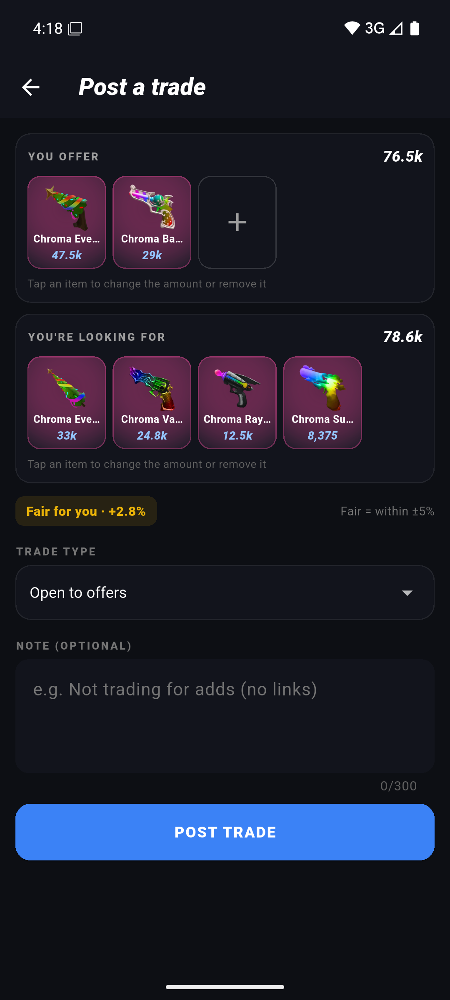
  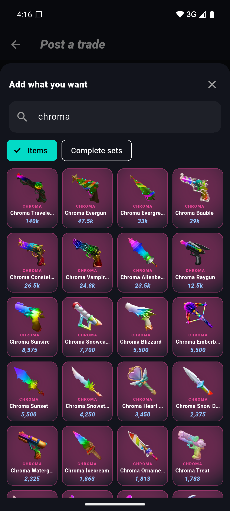
  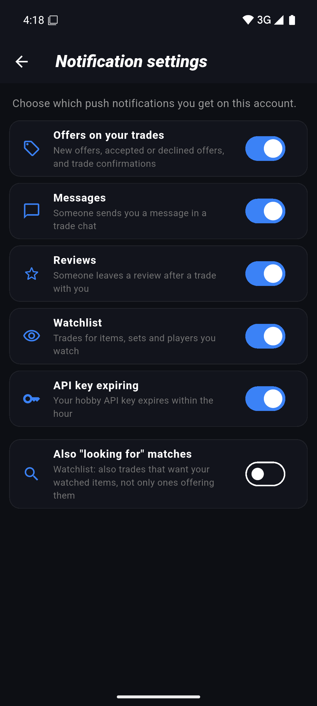

  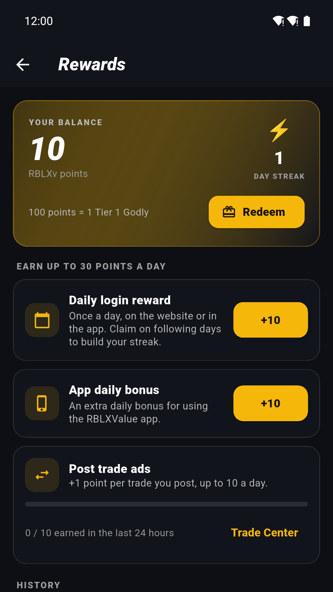
  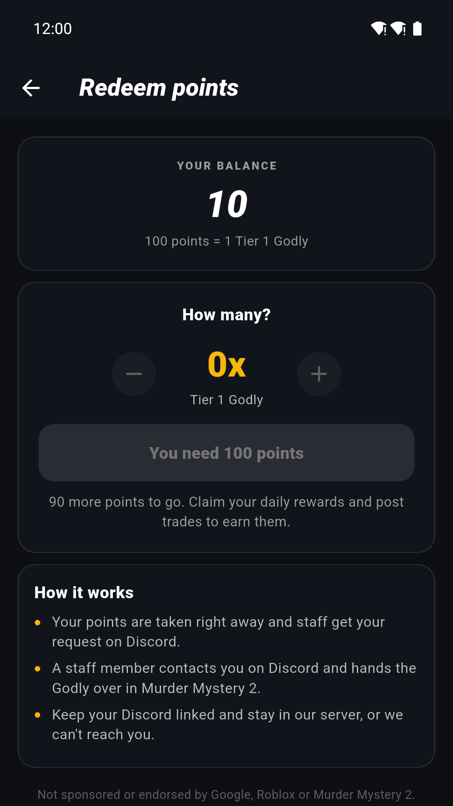

## Download

- **Android:** [Get it on Google Play](https://play.google.com/store/apps/details?id=com.rblxvalue.app)
- **iOS:** not available yet
- **Web:** [rblxvalue.com](https://rblxvalue.com) works on any device, no install needed

## Related projects

| Project | Description |
| --- | --- |
| [rblxvalue.com](https://rblxvalue.com) | MM2 value list, trade calculator, inventory calculator and Trade Center |
| [RBLXValue-API](https://github.com/UN6107617/RBLXValue-API) | Examples and client snippets for the free RBLXValue API v2 |
| [mm2-value-discord-bot](https://github.com/UN6107617/mm2-value-discord-bot) | Ready-to-use Discord bot that looks up MM2 item values |
| [RBLXValue](https://github.com/UN6107617/RBLXValue) | About the RBLXValue website |

## FAQ

**Is the app free?**
Yes. The app is free and shows ads: an optional rewarded ad to keep a free API key active, and an occasional full-screen ad after posting a trade or sending an offer.

**Do I need an account?**
No. Values, search, sets and the trade calculator work without logging in. Inventory, watchlist, notifications and the Trade Center need a Roblox login.

**Does RBLXValue trade items for me?**
No. Trades are only posted and agreed on RBLXValue. The items are always traded inside Roblox itself; RBLXValue never holds or transfers items.

**Where can I delete my account?**
In the app menu under "Delete account", or at [rblxvalue.com/account/delete](https://rblxvalue.com/account/delete).

## Support

- Website: [rblxvalue.com/contact](https://rblxvalue.com/contact)
- Privacy policy: [rblxvalue.com/policy/privacy](https://rblxvalue.com/policy/privacy)
- Terms of service: [rblxvalue.com/policy/tos](https://rblxvalue.com/policy/tos)

---

Values are community estimates and can change at any time. RBLXValue is an independent fan project and is not affiliated with, endorsed by or connected to Roblox Corporation or the creators of Murder Mystery 2. Roblox and Murder Mystery 2 are trademarks of their respective owners. This repository contains no app source code.
